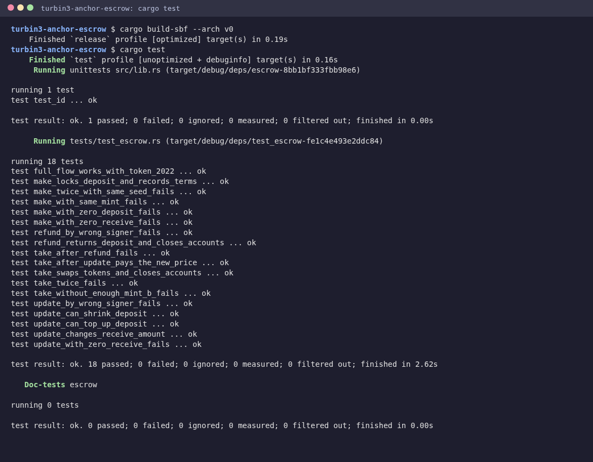

# turbin3-anchor-escrow

A trustless token swap on Solana, written in Anchor for Week 2 of the Turbin3 Builders Cohort.

A **maker** locks some amount of token A in a vault and says how much of token B they want for it. Any **taker** can accept: in one transaction they pay the maker in token B and receive the whole vault in token A. Nobody has to trust anybody, because the program, not a person, controls the vault. Until someone takes the offer, the maker can change the price, resize the deposit, or cancel and get a full refund.

Program id: `Du6GA4zfpnQByPxcC1DPZ1tHzBPrQyMpEn7Ehv6HHwud`

## Accounts

```
 maker ──make──► escrow PDA  ["escrow", maker, seed]
                 { seed, maker, mint_a, mint_b, receive, bump }
                    │ authority
                    ▼
                 vault = ATA(escrow, mint_a)   holds the deposit
                    │
 taker ──take──►    ├─ token B: taker_ata_b ──► maker_ata_b
                    ├─ token A: vault ──► taker_ata_a
                    └─ close vault + escrow, rent ──► maker
```

| Account | Type | Seeds / derivation | Purpose |
|---|---|---|---|
| `escrow` | `Account<Escrow>` | `["escrow", maker, seed.to_le_bytes()]` | Stores the terms: maker, both mints, amount of B wanted, bump |
| `vault` | `InterfaceAccount<TokenAccount>` | ATA of (`escrow`, `mint_a`) | Holds the maker's token A; only the escrow PDA can move it |
| `maker_ata_a` / `maker_ata_b` | `InterfaceAccount<TokenAccount>` | ATA of (maker, mint) | Maker's source of A and destination of B |
| `taker_ata_a` / `taker_ata_b` | `InterfaceAccount<TokenAccount>` | ATA of (taker, mint) | Taker's destination of A and source of B |
| `mint_a` / `mint_b` | `InterfaceAccount<Mint>` | – | The two tokens being swapped |

The `seed` lets one maker run several offers at the same time. All token accounts use `TokenInterface`, so the same program works with both SPL Token and Token-2022 mints.

## Instructions

| Instruction | Signer | Args | What it does |
|---|---|---|---|
| `make` | maker | `seed, deposit, receive` | Creates the escrow and the vault ATA, records the terms, and moves `deposit` of token A into the vault |
| `take` | taker | – | Sends `receive` of token B to the maker (creating the maker's ATA if needed), sends the whole vault to the taker (creating the taker's ATA if needed), then closes the vault and the escrow and refunds their rent to the maker |
| `refund` | maker | – | Sends the vault back to the maker and closes the vault and the escrow |
| `update` | maker | `new_receive, new_deposit: Option<u64>` | Changes the amount of token B wanted. If `new_deposit` is set, tops the vault up from the maker or hands the difference back, so the vault holds exactly `new_deposit` |

Every token movement uses `transfer_checked`, so the token program verifies the mint and its decimals on every transfer.

## Security checks

| Check | Where | Error |
|---|---|---|
| Only the maker can refund or update: `has_one = maker`, and the escrow PDA is re-derived from the stored maker and seed | `refund`, `update`, `take` | `Unauthorized` |
| Mints passed in must be the ones stored in the escrow (`has_one = mint_a / mint_b`) | `take`, `refund`, `update` | `InvalidMint` |
| Vault must be the escrow's ATA for `mint_a` under the given token program | all | Anchor constraint |
| Token A and token B must be different mints | `make` | `SameMint` |
| `deposit`, `receive`, `new_receive` and `new_deposit` must be > 0 | `make`, `update` | `InvalidAmount` |
| Deposit adjustments use checked math | `update` | `MathOverflow` |
| One escrow per (maker, seed): `init` fails if it already exists | `make` | system "already in use" |
| After `take` or `refund` the escrow is closed, so it can't be taken or refunded again | `take`, `refund` | `AccountNotInitialized` |
| The taker must actually hold `receive` of token B, or the whole swap reverts | `take` | token program "insufficient funds" |

The vault is drained and closed in the same instruction that closes the escrow, so there is never an escrow without its vault, or a vault left with tokens that nobody can sign for.

## Build and test

Requirements: Rust (the repo pins 1.89.0 in `rust-toolchain.toml`), the Solana CLI (I used Agave 4.3.1) and optionally Anchor CLI 1.1.2. Built with `anchor-lang` and `anchor-spl` 1.1.2.

```bash
git clone https://github.com/viraj-mahida/turbin3-anchor-escrow.git
cd turbin3-anchor-escrow

# build the program to target/deploy/escrow.so
cargo build-sbf --arch v0

# run the LiteSVM tests (they load the .so from target/deploy)
cargo test
```

`anchor test --skip-build` runs the same two steps through the script in `Anchor.toml` (a plain `anchor build` uses the default SBPF v3 target, which LiteSVM 0.10 can't load).

> **Why `--arch v0`?** Agave 4.x defaults `cargo build-sbf` to SBPF v3. LiteSVM 0.10 can't load a v3 binary yet, so I build for v0, the most widely supported target.

The tests are in Rust with [LiteSVM](https://github.com/LiteSVM/litesvm), in [`programs/escrow/tests/test_escrow.rs`](programs/escrow/tests/test_escrow.rs). LiteSVM ships with the SPL Token, Token-2022 and Associated Token programs, and I write the mint and starting token accounts straight into the SVM, so every test starts from a known state in a few milliseconds.

| Test | Checks |
|---|---|
| `make_locks_deposit_and_records_terms` | Vault holds the deposit, is owned by the escrow PDA, and the escrow stores the right terms |
| `make_with_zero_deposit_fails` / `make_with_zero_receive_fails` | `InvalidAmount` |
| `make_with_same_mint_fails` | `SameMint` |
| `make_twice_with_same_seed_fails` | Can't overwrite a live offer |
| `take_swaps_tokens_and_closes_accounts` | Taker gets A, maker gets B, both accounts closed, maker gets both rents back |
| `take_without_enough_mint_b_fails` | Whole swap reverts, vault untouched |
| `take_twice_fails` | A taken offer is gone |
| `take_after_refund_fails` | `AccountNotInitialized`, taker keeps their B |
| `take_after_update_pays_the_new_price` | Taker pays the updated amount |
| `refund_returns_deposit_and_closes_accounts` | Maker is made whole, both accounts closed |
| `refund_by_wrong_signer_fails` | `Unauthorized`, vault untouched |
| `update_changes_receive_amount` | New price stored, deposit unchanged |
| `update_can_top_up_deposit` / `update_can_shrink_deposit` | Vault ends at exactly `new_deposit`, maker balance adjusts |
| `update_with_zero_receive_fails` | `InvalidAmount` |
| `update_by_wrong_signer_fails` | `Unauthorized`, terms and vault unchanged |
| `full_flow_works_with_token_2022` | make + take with Token-2022 mints |



## What I learned

- **The PDA is the escrow agent.** The vault's authority is the escrow PDA, so no wallet can touch the tokens. The program signs with `["escrow", maker, seed, bump]` only inside `take`, `refund` and `update`, after the checks pass.
- **Atomicity is the trust.** `take` pays the maker and releases the vault in one transaction. If the taker is short on token B, everything reverts and the vault never moves, so neither side can be left half-paid.
- **Constraint order matters.** My first version derived the escrow seeds from the signer, so a wrong signer failed with a generic `ConstraintSeeds`. Deriving them from the stored `escrow.maker` lets `has_one = maker @ Unauthorized` fire instead, which gives a clear error and still pins the right account.
- **`TokenInterface` and `transfer_checked`.** Writing against the interface means one program handles SPL Token and Token-2022, and `transfer_checked` makes the token program verify mint and decimals on every move. The Token-2022 test proves it.
- **Closing accounts is part of the design.** Closing the vault (a token-program CPI signed by the PDA) and the escrow (`close = maker`) gives the maker their rent back and makes replaying `take` or `refund` impossible.
- **`init_if_needed` is a UX tool.** The taker shouldn't need to set up a token-A account first, and the maker shouldn't need a token-B account before posting an offer, so `take` creates both ATAs when they're missing, paid by the taker.

## Where this applies

This is the core of OTC desks and peer-to-peer token swaps, NFT-for-token trades, and any marketplace where two strangers exchange assets without a middleman. The same make / take / refund shape also sits under limit orders, bounty payouts and freelance milestone payments.
